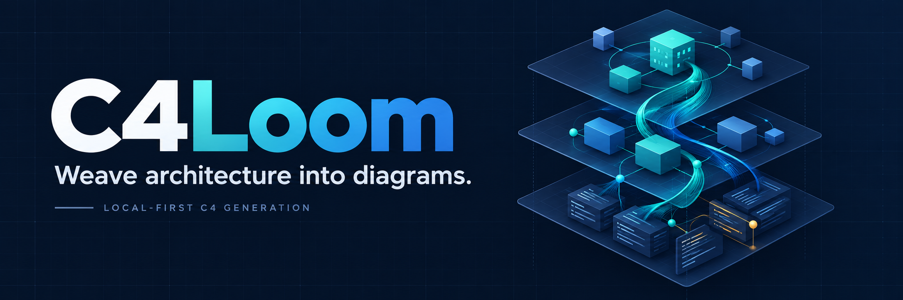
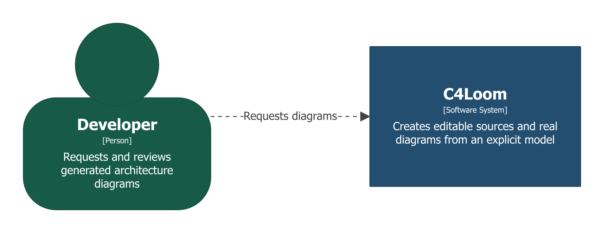
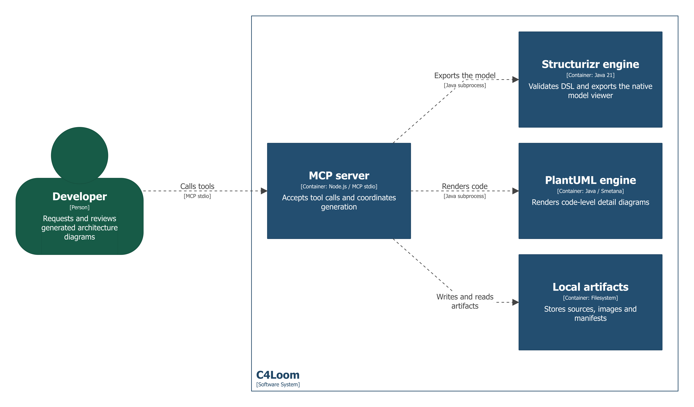
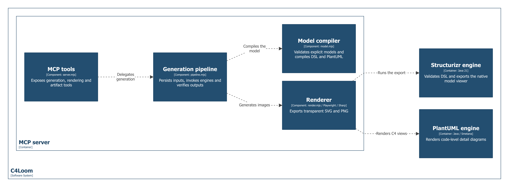
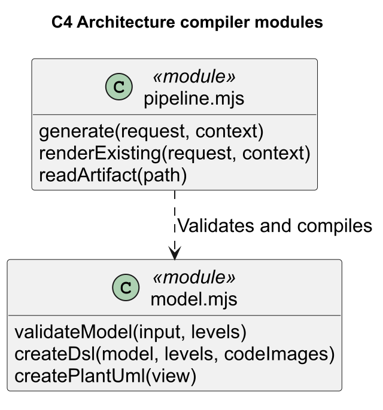

<div align="center">


# C4Loom

### Weave architecture into diagrams.

**A local-first MCP server that generates real C1-C4 diagrams, not just diagram text.**

[](https://github.com/h0w4r/c4loom/actions/workflows/ci.yml)
[](LICENSE)
[](https://nodejs.org/)
[](https://adoptium.net/)
[](https://modelcontextprotocol.io/)
[](#local-first-by-default)

[Quick start](#quick-start) · [Diagram gallery](#diagram-gallery) · [Connect your agent](#connect-your-agent) · [MCP tools](#mcp-tools) · [Contributing](CONTRIBUTING.md)



</div>

## Why C4Loom?

Writing a Structurizr workspace is only part of the job. C4Loom takes the next
step: it validates an explicit architecture model, runs actual rendering
engines, and returns editable sources, transparent images, and an offline
viewer through the Model Context Protocol.

Your agent supplies the architectural facts. C4Loom turns those facts into
inspectable artifacts, with a unique run directory and SHA-256 hashes.

| Capability | What you get |
| --- | --- |
| **All four C4 levels** | System context, containers, components, and explicit code detail. |
| **Native Structurizr rendering** | C1-C3 rendered with Structurizr's own browser visualization. |
| **Real code diagrams** | C4 rendered by PlantUML/Smetana and linked to its component as an image view. |
| **Transparent exports** | SVG and PNG with transparent outer canvases and checked PNG alpha. |
| **Editable outputs** | Architecture JSON, Structurizr DSL/JSON, and PlantUML source. |
| **Traceable runs** | Artifact hashes, engine fingerprints, events, and image verification receipts. |
| **Local-first operation** | No hosted renderer, embedded LLM, API key, Docker, or Graphviz required. |
| **Optional official validation** | Connect the official Structurizr MCP as an additional structural validator. |

## Diagram gallery

These diagrams are generated from the executable
[C4Loom self-architecture example](examples/self-architecture.json).
They describe this tool, not a fictional application.

| C1 · System context | C2 · Containers |
| :---: | :---: |
| [](docs/assets/demo-c1.png) | [](docs/assets/demo-c2.png) |

<details>
<summary><strong>Explore the component and code views</strong></summary>

### C3 · MCP server components



### C4 · Architecture compiler modules



</details>

## Quick start

### Prerequisites

- **Node.js 22+** and npm.
- **Java 21+**, available as `java` or configured through `C4_JAVA`.
- Git, and internet access for the initial dependency and engine downloads.
- Enough disk space for the engines, Chromium, dependencies, and generated runs.

### Install and generate

```sh
git clone https://github.com/h0w4r/c4loom.git
cd c4loom
npm ci
npm run setup
npx playwright install chromium
npm run demo
```

On Linux, install browser system libraries with
`npx playwright install --with-deps chromium` when needed.

The demo connects through a **real MCP stdio client**, generates all four levels,
and prints the output directory, manifest, and viewer paths. Open the resulting
`viewer/index.html` in a browser to navigate the model.

The repository is public, but the npm package is intentionally marked
`private`: install from Git; no published npm package is required.

## Connect your agent

### Any MCP client supporting stdio

Use absolute paths appropriate to your machine:

```json
{
  "mcpServers": {
    "c4loom": {
      "command": "node",
      "args": ["/absolute/path/to/c4loom/src/server.mjs"],
      "env": {
        "C4_OUTPUT_ROOT": "/absolute/path/to/diagram-output"
      }
    }
  }
}
```

On Windows, use forward-slash paths such as `C:/tools/c4loom/src/server.mjs`.
The enclosing configuration format varies by client; the command, arguments,
and environment above are the stdio connection settings.

The server reserves `stdout` for MCP JSON-RPC and writes progress to `stderr`.
If `node` or `java` is unavailable in the client's environment, specify its
absolute executable path.

### Codex project configuration

```sh
npm run configure -- --project /absolute/path/to/your/project
```

This adds a `c4loom` entry to that project's `.codex/config.toml`, without
changing global settings or replacing existing server entries. If the entry
already exists, the command stops without changing it.

With no `--project` argument, it registers in the C4Loom checkout itself.
The target project must be trusted by Codex. Reload MCP connections or start
a new session if the client was already open.

### Example request to your agent

> Use C4Loom to generate the four C4 levels for this repository. Inspect the
> implementation first, build an explicit architecture model, and do not invent
> components or code members. Return the PNG/SVG paths and the offline viewer.

The agent must map verified architectural facts into the tool's model schema.
C4Loom does **not** reverse-engineer a repository by itself.

## MCP tools

| Tool | Input | Result |
| --- | --- | --- |
| `generate_c4` | `project`, `model`, optional `levels` | Real C1-C4 diagrams, editable sources, viewer, and manifest. |
| `render_structurizr` | `project`, self-contained `dsl` | Real C1-C3 images from an existing workspace. |
| `read_artifact` | Absolute artifact `path` | A PNG image or supported text artifact inside the output root. |
| `check_runtime` | No arguments | Engine hash verification and configured runtime information. |

`levels` defaults to `[1, 2, 3, 4]`. A full request requires declared containers,
components, and at least one explicit code view. For a model without code detail,
request only the supported lower levels instead of inventing it.

`check_runtime` verifies engine files; it does not prove that Java, Chromium,
the MCP client, and image generation work together. Run the demo or E2E suite
to test the complete path.

### Architecture model

| Field | Meaning |
| --- | --- |
| `model.title`, `model.description` | Workspace identity and purpose. |
| `model.focalSystem` | Identifier of the system to detail. |
| `model.people[]` | People with `id`, `name`, and `description`. |
| `model.systems[].containers[]` | Systems and their containers. |
| `model.systems[].containers[].components[]` | Components within each container. |
| `model.relationships[]` | Explicit `source`, `target`, `description`, and optional `technology`. |
| `model.codeViews[]` | Code views attached to components in the focal system. |
| `model.codeViews[].elements[]` | Classes, interfaces, modules, procedures, or records. |
| `model.codeViews[].relationships[]` | Dependencies, associations, composition, or inheritance. |

See the complete [working model](examples/self-architecture.json) and the
[schema and compiler](src/model.mjs). Identifiers must start with an ASCII
letter and contain only ASCII letters, numbers, or underscores. References
must point to declared elements. Names and descriptions preserve the supplied
language; generated C4 terminology defaults to English.

## What each run produces

```text
output/<project>/<run-id>/
├── architecture.json
├── workspace.dsl
├── workspace.json
├── manifest.json
├── diagrams/
│   ├── C1_context.svg / .png / .image.json
│   ├── C2_containers.svg / .png / .image.json
│   ├── C3_<container>.svg / .png / .image.json
│   └── C4_<view>.puml / .svg / .png / .image.json
└── viewer/
    └── index.html + local viewer assets
```

Each generation gets a new UUID directory. The manifest records engine
versions, requested views, rendering events, artifact sizes, and SHA-256
hashes. Image receipts record dimensions, visible pixels, and corner alpha.
Run directories also preserve engine logs for diagnosis.

Transparency applies to the outer canvas. Diagram nodes, component boundaries,
and other intentional visual elements may retain their own fills.

## How it works

1. **Validate** the explicit architecture contract and element references.
2. **Compile** Structurizr DSL and code-view PlantUML.
3. **Render C4** locally with PlantUML's Smetana layout engine.
4. **Parse and export** the complete workspace with the official Structurizr engine.
5. **Render C1-C3** using the native Structurizr browser export API in Chromium.
6. **Verify and persist** transparent images, editable sources, viewer, and manifest.

The C4 code view is a PlantUML-rendered image associated with a Structurizr
component. It is not presented as a native Structurizr UML renderer.

### Local-first by default

Rendering uses local engines and browser assets. By default, architecture
models are not sent to an external validation or rendering service. Initial
installation downloads dependencies, Chromium, and pinned engine artifacts.

Imported DSL is deliberately restricted: no executable `!` directives,
workspace inheritance, external URLs, themes, icons, or image resources.
Artifact reads are confined to the configured output root, including checks
against escaping links and junctions. Run C4Loom with trusted local clients;
these checks are not a general-purpose hostile-code sandbox.

### Optional official Structurizr MCP

Set `C4_OFFICIAL_MCP_URL` to add the official server's `validate` tool to the
pipeline. The validator must return `OK`; rejection or connection failure stops
the run rather than silently skipping a configured dependency.

Loopback endpoints work without extra opt-in. Non-loopback endpoints also
require `C4_ALLOW_REMOTE_OFFICIAL=1`. Enabling one sends the structural DSL
to that service.

This supplementary validation excludes local C4 image references because the
official MCP parser restricts filesystem access. The local Structurizr parser
still validates the complete workspace, and PlantUML renders the code detail.
The manifest records the validation scope explicitly.

## Configuration

| Variable | Default / purpose |
| --- | --- |
| `C4_OUTPUT_ROOT` | `<checkout>/output`; allowed root for generated runs and artifact reads. |
| `C4_RUNTIME_DIR` | `<checkout>/.runtime`; pinned engines and `engines.json`. |
| `C4_JAVA` | `java`; optional Java executable override. |
| `C4_CHROMIUM` | Playwright-managed Chromium; optional executable override. |
| `C4_NODE_MODULES` | Optional externally managed Node package directory. |
| `C4_IDLE_MS` | `120000`; engine inactivity window, not total execution time. |
| `C4_DOWNLOAD_IDLE_MS` | `120000`; download inactivity window. |
| `C4_CONNECT_MS` | `20000`; official MCP connection/request wait, renewed by tool progress. |
| `C4_OFFICIAL_MCP_URL` | Unset; optional official MCP endpoint. |
| `C4_ALLOW_REMOTE_OFFICIAL` | Unset; set to `1` to permit a non-loopback validator. |

The Codex registration helper explicitly sets the target project's output root
to `.local/c4loom`, separate from the direct server default above.

### Pinned engines

| Engine | Version | Download source |
| --- | --- | --- |
| Structurizr | `2026.09.19` | Official Structurizr distribution. |
| PlantUML MIT | `1.2026.9` | Maven Central `plantuml-mit` artifact. |

`npm run setup` verifies pinned SHA-256 digests before reuse. The PlantUML
digest was checked against Maven Central. The Structurizr pin records the
reviewed official HTTPS download; it is not a vendor signature. Engine binaries
and `node_modules` are not committed.

## Testing

```sh
npm test
npm run test:e2e
```

The E2E suite uses the real MCP SDK over stdio and actual engines. It checks
invalid-input rejection, a real Structurizr parser failure, recovery in the
same session, C1-C4 generation, artifact hash read-back, PNG retrieval through
MCP, an outside-root read rejection, and navigation across all four native
viewer views. PNG transparency checks run during generation.

Local test evidence is written to `.evidence/` and ignored by Git. CI runs unit
and real rendering tests on Windows and Linux; the badge reports the actual
workflow status rather than a hardcoded passing label.

## Troubleshooting

| Symptom | What to check |
| --- | --- |
| Missing engines | Run `npm run setup` in the checkout used by the client. |
| Java launch/version error | Install Java 21+ and check `java -version` or `C4_JAVA`. |
| Chromium executable missing | Run `npx playwright install chromium` as the same OS user. |
| Browser libraries missing on Linux | Run `npx playwright install --with-deps chromium`. |
| Missing code view | Declare `model.codeViews` or request only levels `[1, 2, 3]`. |
| MCP tools not visible | Check absolute paths, project trust, and reconnect the client. |
| Official validation fails | Check the endpoint and enabled DSL tools; inspect the run diagnosis. |

Failed runs keep available diagnostics in their output directory. Long engine
work is monitored for activity rather than cancelled solely for elapsed time.

## Project layout

```text
src/model.mjs       Model schema, validation, DSL and PlantUML compilation
src/pipeline.mjs    Generation, optional validation, manifests, artifact reads
src/render.mjs      Native Structurizr export, code rendering, transparent PNG
src/runtime.mjs     Engine integrity, path boundaries, process supervision
src/server.mjs      Four MCP tools over stdio
scripts/            Setup, project registration, demo, and real E2E clients
examples/           Executable self-architecture model
test/               Contract tests
docs/assets/        Brand assets and real generated diagram examples
```

## Contributing and license

Contributions are welcome. See [CONTRIBUTING.md](CONTRIBUTING.md) for setup,
validation expectations, and pull request guidance.

Original C4Loom code is [MIT licensed](LICENSE). Third-party engines and
dependencies retain their own licenses; see
[THIRD_PARTY_NOTICES.md](THIRD_PARTY_NOTICES.md).

Built on [Structurizr](https://docs.structurizr.com/),
[PlantUML](https://plantuml.com/), and the
[MCP TypeScript SDK](https://github.com/modelcontextprotocol/typescript-sdk/tree/v1.x).
Learn more about the [C4 model](https://c4model.com/) and the
[official Structurizr MCP](https://docs.structurizr.com/ai/mcp).

C4Loom is an independent project, not an official Structurizr product.
